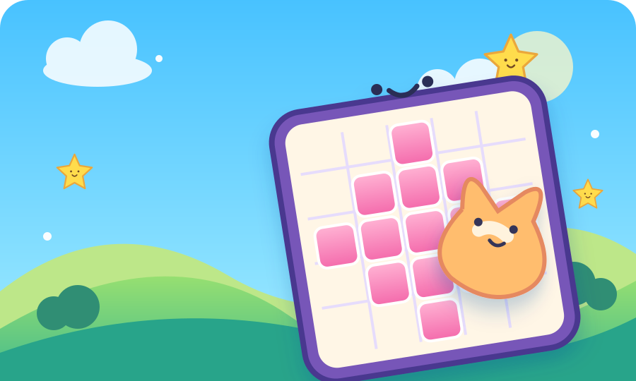
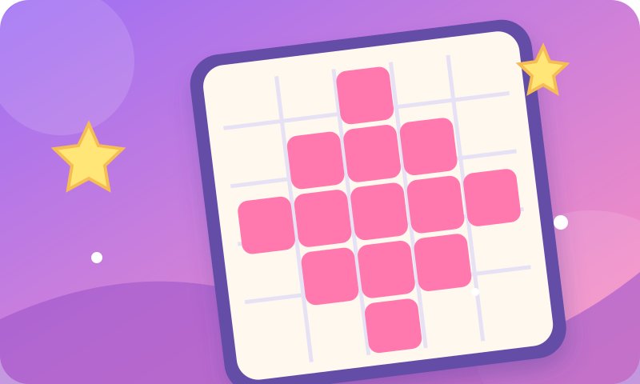
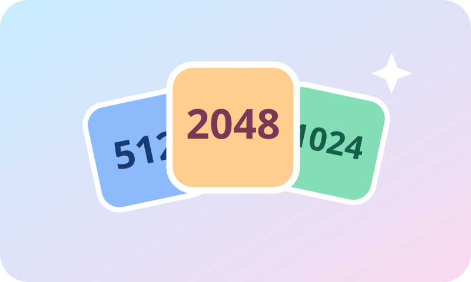
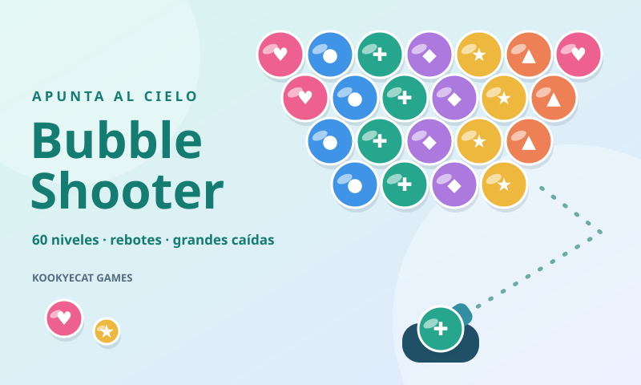
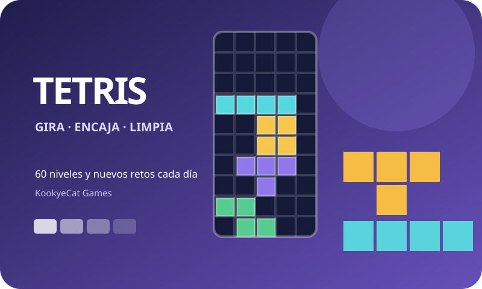
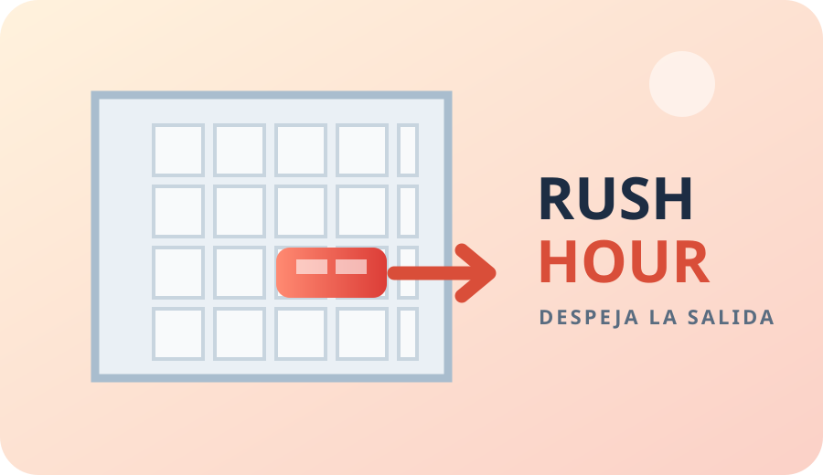

<div align="center">
  <a href="https://djl.com.es/games/">
    
  </a>
  <h1>KookyeCat Games</h1>
  <p><strong>Un pequeño mundo de juegos para disfrutar. Y volver a jugar.</strong></p>
  <p>Arcade web instalable · Progreso local · Ratón, teclado y táctil</p>
  <p>
    <a href="https://djl.com.es/games/"></a>
    
    
  </p>
</div>

KookyeCat Games reúne juegos de lógica, estrategia y puntería en una web estática pensada para crecer hasta aproximadamente 50 juegos. Cada título tiene sus propias reglas, modos, puntuación, premios y progreso, dentro de una interfaz común que pone el tablero por delante de todo lo demás.

**Sin cuentas, inicio de sesión, telemetría ni sincronización de partidas.** El progreso se conserva en el dispositivo del jugador. Las tarjetas y las copias de seguridad se generan localmente.

[Jugar](https://djl.com.es/games/) · [Juegos](#juegos-disponibles) · [Tecnologías](#tecnologías) · [Desarrollo](#desarrollo-local) · [Arquitectura](#arquitectura) · [Añadir un juego](#añadir-un-juego) · [Despliegue](#despliegue-manual)

## Qué ofrece la arcade

- **Cinco juegos y 300 niveles de campaña**, además de contrarrelojes y retos diarios.
- **PWA instalable** con caché de los recursos principales y actualización automática.
- **Interfaz unificada**, adaptable a escritorio, tablet y móvil, con pantalla completa.
- **Logros y trofeos con insignias propias**, dificultad visible y vitrina filtrable.
- **Récords y estadísticas locales**, con puntuación propia por juego y XP común de arcade.
- **Tarjetas de progreso PNG** para descargar en PC o compartir desde dispositivos móviles compatibles.
- **Backups ZIP individuales y globales**, validados antes de restaurarse.
- **Sonidos suaves y sin música**, con interruptor y preferencia independiente por juego.
- **Un gato azul de vóxeles** que saluda, juega y celebra sin tapar el tablero ni los controles.

## Tecnologías

<div align="center">
  
  
  
  
  
  
</div>

| Tecnología | Uso en el proyecto |
| --- | --- |
| HTML, CSS y JavaScript modular | Aplicación estática, sin framework ni proceso de compilación obligatorio. |
| CSS Grid, Flexbox y media queries | Distribución común y adaptación a móvil, tablet y escritorio. |
| Canvas 2D | Tableros Canvas 2D de Tetris y Bubble Shooter, además de tarjetas PNG. |
| SVG y WebP | Portadas, iconos, insignias y poses de la mascota. |
| IndexedDB | Perfil, partidas, récords y premios. `localStorage` actúa como alternativa y conserva preferencias. |
| Service Worker y Cache API | Caché de la aplicación y recursos para uso offline. |
| Web Audio API | Efectos sonoros sintetizados; no necesita pistas de música ni archivos de audio. |
| Web Share API y File API | Compartir imágenes cuando el dispositivo lo admite y trabajar con archivos locales. |
| JavaScript y JSON | Motor de logros, contratos de eventos, manifiestos y formato de progreso. |

**Herramientas de desarrollo y publicación:** Git/GitHub, Node.js para comprobaciones, Python para servir la web localmente y Pillow para regenerar algunos gráficos. El navegador no necesita Node.js, Python ni un backend para ejecutar los juegos.

## Juegos disponibles

| Juego | Campaña | Otros modos | Premios propios | Jugar |
| --- | --- | --- | --- | --- |
| **Picross** | 60 niveles | Contrarreloj y reto diario | 41 | [Abrir Picross](https://djl.com.es/picross/) |
| **Fusión 2048** | 60 niveles | Contrarreloj de 180 s y reto diario | 35 | [Abrir Fusión 2048](https://djl.com.es/2048/) |
| **Bubble Shooter** | 60 niveles | Contrarreloj de 120 s y reto diario | 35 | [Abrir Bubble Shooter](https://djl.com.es/bubbleshooter/) |
| **Tetris** | 60 niveles | Contrarreloj de 120 s y reto diario | 35 | [Abrir Tetris](https://djl.com.es/tetris/) |
| **Rush Hour** | 60 niveles | Contrarreloj de 120 s y reto diario | 35 | [Abrir Rush Hour](https://djl.com.es/games/rush/) |

### Picross

<a href="https://djl.com.es/picross/"></a>

Descubre dibujos ocultos interpretando las pistas de cada fila y columna. Los números indican grupos consecutivos de casillas rellenas; las cruces ayudan a anotar los espacios vacíos. La campaña contiene 20 niveles de 5 × 5, 20 de 10 × 10 y otros 20 avanzados de 10 × 10, diseñados para resolverse por deducción.

Rellenar mal consume un corazón. Una cruz equivocada muestra un aviso visual durante dos segundos sin quitar vidas ni bloquear el resto del tablero. El juego incluye pistas lógicas; en contrarreloj, un error también resta 15 segundos.

**Controles:** tocar o arrastrar con dedo o ratón; flechas para moverse entre celdas, F para rellenar y X para marcar vacío. El clic derecho permite marcar huecos.

**Carpeta:** [`picross/`](picross/) · **Manifiesto:** [`game.json`](picross/game.json) · **Copia individual:** `picross.zip`.

### Fusión 2048

<a href="https://djl.com.es/2048/"></a>

Desliza las casillas de un tablero de 4 × 4 y une números iguales para alcanzar la meta de cada nivel. Después de cada movimiento válido aparece una nueva casilla: colocar bien las piezas es tan importante como conseguir una gran fusión.

La campaña desbloquea 60 niveles de forma progresiva. El contrarreloj ofrece 180 segundos para alcanzar la meta y el reto diario utiliza un inicio determinado por la fecha. Puedes deshacer el movimiento anterior, con una penalización en la puntuación final.

**Controles:** deslizar con el dedo, arrastrar con el ratón, usar los botones de dirección o pulsar las flechas/WASD con el foco en el tablero. Ctrl/Cmd + Z deshace cuando el tablero tiene el foco.

**Carpeta:** [`2048/`](2048/) · **ID interno:** `fusion-2048` · **Manifiesto:** [`game.json`](2048/game.json) · **Copia individual:** `2048.zip`.

### Bubble Shooter

<a href="https://djl.com.es/bubbleshooter/"></a>

Apunta, rebota en las paredes y une al menos tres burbujas del mismo color. Las que pierdan su conexión con el techo caerán, permitiendo despejar grandes zonas con un solo disparo. La guía de trayectoria ayuda a preparar carambolas, y cada color tiene un símbolo para distinguirlo mejor.

Incluye 60 niveles, contrarreloj de 120 segundos y un reto diario reproducible. Puedes intercambiar las dos burbujas una vez por tiro. Cada seis disparos sin eliminar un grupo baja el techo; si las burbujas alcanzan la línea límite, termina la partida. Al guardar se conserva también un disparo que esté en vuelo, y la partida se pausa al recuperarla o pasar a segundo plano.

**Controles:** arrastrar para apuntar y soltar para disparar; con el tablero enfocado, flechas para apuntar, espacio/Enter para disparar, X para cambiar burbuja y P para pausar. También hay botones táctiles equivalentes.

**Carpeta:** [`bubbleshooter/`](bubbleshooter/) · **Manifiesto:** [`game.json`](bubbleshooter/game.json) · **Copia individual:** `bubbleshooter.zip`.

## Una interfaz para todos los juegos

La carcasa visual es común. Cada juego conserva la configuración de su interfaz y los estilos de su tablero dentro de su propia carpeta.

| Zona | Escritorio | Tablet y móvil |
| --- | --- | --- |
| Cabecera | Volver a Arcade, identidad del juego, mascota y tarjeta de progreso. | Cabecera compacta con las mismas acciones principales. |
| Juego | Columna amplia: modos, nivel, cuatro indicadores, tablero y controles. | Primero el juego, con el tablero adaptado al ancho y alto disponibles. |
| Información secundaria | Barra lateral de 276 px: récord, progreso, premios y ayuda. | Debajo del juego; a partir de 600 px o menos, paneles en una columna. |
| Datos | Sección final con tarjeta, descarga de backup, restauración y borrado. | Mismo orden, con acciones apiladas y botones táctiles. |

A 960 px o menos la barra lateral pasa debajo del juego. En tablets verticales de proporciones habituales (3:4 y 4:3), el tablero ocupa todo el ancho disponible y se ajusta al alto útil; los paneles secundarios se ordenan en dos columnas equilibradas y la portada reorganiza la navegación y las tarjetas para ese formato. El tablero mantiene sus proporciones propias y la ayuda se abre bajo demanda. El botón de pantalla completa está junto al selector de nivel; si la API nativa no está disponible, activa un modo ampliado con salida visible y Escape.

La estructura, los breakpoints y el comportamiento común viven en [`game-interface.css`](assets/css/game-interface.css) y [`game-interface.js`](assets/js/game-interface.js). Cada juego los configura desde su `interface.js`. Se respetan el foco por teclado y la preferencia de movimiento reducido.

## Progreso, privacidad y copias

El perfil se guarda en la base IndexedDB `kookye-cat-games-local-v2`, dentro del almacén `player-profile`. El esquema actual de progreso y backups es **2**. Las preferencias de sonido se conservan por juego y las claves utilizan un namespace propio para evitar colisiones con otras aplicaciones del mismo dominio.

| Archivo descargado | Contenido | Dónde restaurarlo |
| --- | --- | --- |
| `games.zip` | Progreso de todos los juegos y perfil general de la arcade. | En la portada. |
| `picross.zip` | Partida, estadísticas, niveles y premios de Picross. | Dentro de Picross. |
| `2048.zip` | Partida, estadísticas, niveles y premios de Fusión 2048. | Dentro de Fusión 2048. |
| `bubbleshooter.zip` | Partida, estadísticas, niveles y premios de Bubble Shooter. | Dentro de Bubble Shooter. |
| `tetris.zip` | Partida, estadísticas, niveles y premios de Tetris. | Dentro de Tetris. |
| `rush.zip` | Partida, estadísticas, niveles y premios de Rush Hour. | Dentro de Rush Hour. |

Las copias incluyen metadatos y se validan por formato, versión y juego antes de restaurarse. Una copia individual solo sustituye el progreso de ese juego. Los archivos se generan y leen en el navegador: no se suben ni se descomprimen en el VPS.

El progreso pertenece al navegador y al dispositivo actuales. Para trasladarlo, exporta una copia e impórtala en el destino. Borrar los datos del sitio puede eliminarlo; la copia ZIP permite recuperarlo. Las actualizaciones normales deben conservar las partidas; cualquier cambio incompatible requiere una migración explícita.

## Logros, trofeos y tarjetas

Cada juego aporta su catálogo de premios, métricas y reglas de puntuación. La arcade añade objetivos de actividad real, como descubrir juegos, jugar distintos modos, visitar en días diferentes o gestionar copias y tarjetas.

- Cada premio tiene un identificador estable, una insignia propia y un nivel de dificultad: bronce, plata, oro o legendario.
- El núcleo carga los catálogos bajo demanda. La vitrina permite filtrar por juego y tipo, buscar y mostrar los premios en bloques de 24.
- La puntuación nativa permanece dentro de cada juego. La primera victoria de un puzle o reto aporta entre 20 y 100 XP normalizados a la arcade.
- El contrato de eventos tiene versión **1**. Los reductores específicos actualizan las métricas de cada juego.
- Las tarjetas de arcade y de cada juego muestran progreso real, récords y premios con sus insignias. Se dibujan localmente y se exportan como PNG.

En escritorio, la acción de tarjeta descarga la imagen. En Android, iPhone y otros dispositivos móviles compatibles utiliza el menú nativo para compartir archivos; si el navegador consume la activación al generar la tarjeta, pide un segundo toque. Siempre existe la alternativa de descarga cuando no se admite compartir la imagen.

## PWA y funcionamiento offline

[`manifest.webmanifest`](manifest.webmanifest) define la instalación, los iconos y el modo independiente. [`sw.js`](sw.js) mantiene una caché versionada con las páginas y recursos principales de los juegos. En producción, la aplicación y el service worker viven bajo `/games/`.

La primera carga necesita conexión para descargar los recursos. Después, el service worker puede servir el contenido cacheado sin red. Las insignias se cargan según se necesitan; no se precarga todo el catálogo de premios en la instalación.

En iPhone/iPad, Safari no muestra un aviso de instalación automática: el botón **Instalar app** de la portada explica cómo usar Compartir → Añadir a pantalla de inicio y activar **Abrir como app web**. Si la opción no aparece, se puede agregar desde Editar acciones. En Safari para Mac indica Archivo → Añadir al Dock. En navegadores compatibles se ofrece el aviso nativo.

La app comprueba la versión al instalarse y, después, como máximo una vez cada seis horas mientras está abierta, visible y con conexión. Al volver a primer plano o recuperar Internet revisa si ya toca comprobar. Las pestañas comparten la marca de última comprobación; no hay sondeos frecuentes ni una API de actualización. Mientras no haya cambios solo se consulta el pequeño script del service worker. Si detecta una versión nueva, el worker descarga la caché de recursos una sola vez, la activa y recarga la app guardando antes la partida. Al terminar, muestra un aviso de actualización.

Para publicar una versión, actualizar la caché versionada del service worker y mantener sus rutas alineadas con el árbol del proyecto. Los navegadores también pueden realizar sus propias comprobaciones de actualización según sus reglas.

### Tetris

<a href="https://djl.com.es/tetris/"></a>

Gira y encaja las siete piezas para completar filas horizontales. Las líneas desaparecen, suman puntos y hacen que las piezas caigan más rápido. La campaña ofrece 60 metas progresivas; el reto diario propone el mismo tablero inicial durante ese día y el contrarreloj da 120 segundos para completar 15 filas.

**Controles:** botones táctiles y gestos sobre el tablero: toca o desliza hacia arriba para girar, arrastra a izquierda/derecha para mover la pieza mientras mantienes el dedo apoyado, desliza hacia abajo para bajar una o varias filas y haz un gesto largo o rápido hacia abajo para caída rápida. En escritorio, usa las flechas para mover/bajar, arriba o X para girar, espacio para caída rápida y P para pausar. El juego también ofrece sonidos suaves con interruptor, progreso local y una colección de 35 insignias propias.

**Carpeta:** [`tetris/`](tetris/) · **Manifiesto:** [`game.json`](tetris/game.json) · **Copia individual:** `tetris.zip`.

### Rush Hour

<a href="https://djl.com.es/games/rush/"></a>

Despeja el atasco desplazando cada vehículo únicamente por su carril. El objetivo es abrir una ruta hasta el borde derecho para que salga el coche rojo. La campaña contiene 60 tableros diferentes de 6 × 6, ordenados por dificultad real: entre 9 y 30 desplazamientos mínimos de vehículos. Cada mínimo se calcula mediante búsqueda exhaustiva por amplitud, contando un desplazamiento continuo de cualquier longitud como una jugada. El contador de la interfaz cuenta casillas recorridas. Los tableros están precalculados: no se ejecuta el solucionador en el navegador ni en el VPS. Las partidas antiguas en curso se reinician al actualizar; los niveles desbloqueados y los récords se conservan.

Incluye contrarreloj de 120 segundos y reto diario determinista. Puedes arrastrar los coches con el dedo o el ratón, seleccionarlos y moverlos con los botones o usar las flechas del teclado; Intro saca el coche rojo cuando la salida está libre. También ofrece deshacer, pausa, efectos suaves con interruptor, progreso local y 35 insignias propias.

**Carpeta:** [`rush/`](rush/) · **Manifiesto:** [`game.json`](rush/game.json) · **Copia individual:** `rush.zip` · **Destino VPS:** `/var/www/djl.com.es/games/rush/`.

## Desarrollo local

### Requisitos

- Un navegador moderno con módulos ES.
- Python 3 u otro servidor HTTP estático para la vista local.
- Node.js para ejecutar las comprobaciones y los generadores JavaScript.
- Pillow, solo si vas a regenerar imágenes con los scripts Python.

No hay que ejecutar `npm install` ni compilar la aplicación para jugar o servirla.

```bash
git clone https://github.com/DavidJLlanes/KookyeCatGames.git
cd KookyeCatGames
python -m http.server 8080
```

En Windows puedes usar `py -m http.server 8080` si ese es el lanzador instalado. Abre [http://localhost:8080/](http://localhost:8080/). Los juegos estarán bajo `/picross/`, `/2048/`, `/bubbleshooter/` y `/tetris/` en ese servidor local.

Sirve el proyecto por HTTP; abrir los HTML directamente como archivos no reproduce correctamente el funcionamiento de los módulos ni de la PWA. En producción, utiliza HTTPS para las funciones de instalación y compartición compatibles.

### Comprobaciones

Desde la raíz del repositorio:

```bash
node scripts/check-game-interfaces.mjs
node --test bubbleshooter/engine.test.mjs
```

La primera comprobación revisa el contrato de las cuatro interfaces, los identificadores de controles, el orden de los paneles, las rutas de recursos, los estados de modo y la lógica de pantalla completa. Las pruebas de Bubble Shooter cubren, entre otros casos, el tablero hexagonal, los rebotes, los grupos, las caídas, el guardado de tiros y los backups.

Estas comprobaciones no sustituyen la revisión en navegador: verificar escritorio y móvil, orientación, teclado, táctil, foco, reinicio, final de partida, persistencia, compartir, restauración y actualización offline antes de publicar cambios de interfaz.

### Generación de recursos

| Comando | Recursos |
| --- | --- |
| `python scripts/render-graphics.py` | Iconos PNG de instalación y tarjeta Open Graph general. |
| `python 2048/generate-icons.py` | Insignias SVG de Fusión 2048. |
| `node bubbleshooter/generate-art.mjs` | Portada, icono e insignias SVG de Bubble Shooter. |
| `python bubbleshooter/render-cover.py` | Portada Open Graph PNG de Bubble Shooter, de 1200 × 630. |

Los generadores Python que crean imágenes rasterizadas requieren Pillow. `render-cover.py` utiliza una ruta de fuentes de Windows; adapta esa ruta si lo ejecutas en otro sistema operativo.

## Arquitectura

| Ruta | Responsabilidad |
| --- | --- |
| [`index.html`](index.html) | Portada, catálogo, progreso general y acceso a la vitrina. |
| [`core/game-registry.js`](core/game-registry.js) | Registro ligero: identidad, rutas, modos, niveles, catálogo y estado inicial de cada juego. |
| [`core/events.js`](core/events.js) | Contrato versionado de eventos de juego y actividad de la arcade. |
| [`core/achievements.js`](core/achievements.js) | Carga diferida, consulta y evaluación de catálogos de premios. |
| [`core/arcade-achievements.js`](core/arcade-achievements.js) | Objetivos comunes de actividad y dominio de la arcade. |
| [`core/scores.js`](core/scores.js) | Conversión de primeras victorias a XP común. |
| [`assets/js/`](assets/js/) | Almacenamiento, ZIP, backups, tarjetas, sonidos, mascota y actualizaciones. |
| [`assets/css/`](assets/css/) | Identidad visual general, interfaz compartida y componentes comunes. |
| [`assets/art/`](assets/art/) y [`assets/mascot/`](assets/mascot/) | Ilustraciones e imágenes de la mascota. |
| Carpetas [`picross/`](picross/), [`2048/`](2048/), [`bubbleshooter/`](bubbleshooter/), [`tetris/`](tetris/) y [`rush/`](rush/) | Cada juego ocupa una subcarpeta directa de la raíz de la arcade. |
| [`scripts/`](scripts/) | Comprobaciones y generación de recursos. |
| [`AGENTS.md`](AGENTS.md) | Normas permanentes de diseño, arquitectura, privacidad y ampliación. |

El núcleo no importa directamente las reglas de ningún juego. Cada juego aporta su reductor de eventos y catálogo, incluido Rush Hour; la portada consulta estos datos mediante el registro común. Cada juego aporta su reductor de eventos y su catálogo, y conserva sus datos bajo un ID estable. La portada agrega la información a través del registro. Esta separación permite añadir juegos sin convertir el núcleo en un archivo monolítico.

## Añadir un juego

1. Crear `<carpeta>/` en la raíz del repositorio, al mismo nivel que `index.html`, con `index.html`, `game.json`, `interface.js`, lógica, reglas, puntuación, controles, catálogo de premios y recursos propios.
2. Declarar en el manifiesto identidad, versión, modos —como máximo tres—, esquema de progreso y configuración de interfaz.
3. Registrar metadatos y estado inicial en `core/game-registry.js`; cargar el catálogo de premios bajo demanda.
4. Reutilizar la interfaz común y mantener el tablero como protagonista. Conservar el orden de paneles y la versión responsive compartida.
5. Implementar táctil, ratón y teclado, foco accesible, movimiento reducido y sonidos suaves con interruptor, sin música.
6. Integrar guardado local, récords, estadísticas, eventos versionados, XP y objetivos de corto y largo plazo.
7. Preparar portada, iconos, insignias propias y tarjeta de progreso. Integrar el backup `<carpeta>.zip` y el global `games.zip`.
8. Añadir los recursos principales a la estrategia offline y coordinar las versiones de caché, HTML y módulos.
9. **Actualizar este README antes de publicar:** añadir el juego a la tabla y crear una descripción con imagen, mecánica, modos, controles, niveles, premios, carpeta, enlace y nombre del backup.
10. Revisar las comprobaciones automáticas y probar la experiencia en escritorio y móvil. Publicar en `main` después de revisar y proporcionar el comando de despliegue manual.

Cada nuevo juego debe quedar documentado en el README principal. Si cambia un juego existente, actualizar también su descripción y los datos del catálogo.

## Despliegue manual

El destino de producción es `/var/www/djl.com.es/games/` en un VPS Ubuntu. `index.html`, los recursos compartidos y `core/` van en esa raíz; los juegos van directamente en `/var/www/djl.com.es/games/<id>/` (por ejemplo, `/var/www/djl.com.es/games/tetris/`). No se debe desplegar en `/var/www/djl.com.es/games/games/<id>/`. El servidor solo tiene que servir archivos estáticos; no necesita un proceso Node.js, una base de datos remota ni un backend de partidas.

Desde una copia del repositorio en el VPS, situada fuera del directorio de destino:

```bash
git pull --ff-only origin main
sudo install -d -o www-data -g www-data /var/www/djl.com.es/games
sudo rsync -av --exclude='.git/' ./ /var/www/djl.com.es/games/
sudo chown -R www-data:www-data /var/www/djl.com.es/games
```

También puedes copiar directamente la rama `main` sin mantener un clon en el VPS:

```bash
sudo install -d -o www-data -g www-data /var/www/djl.com.es/games
curl -fL https://codeload.github.com/DavidJLlanes/KookyeCatGames/tar.gz/refs/heads/main | sudo tar -xz --strip-components=1 -C /var/www/djl.com.es/games
sudo chown -R www-data:www-data /var/www/djl.com.es/games
```

El alojamiento debe exponer ese directorio en [https://djl.com.es/games/](https://djl.com.es/games/). Los comandos se limitan al directorio del proyecto y no utilizan `--delete`. Para desplegar una revisión concreta, sustituye `refs/heads/main` por el SHA completo del commit revisado.

El despliegue se ejecuta manualmente. Publicar cambios en GitHub no significa desplegarlos automáticamente en el VPS.
